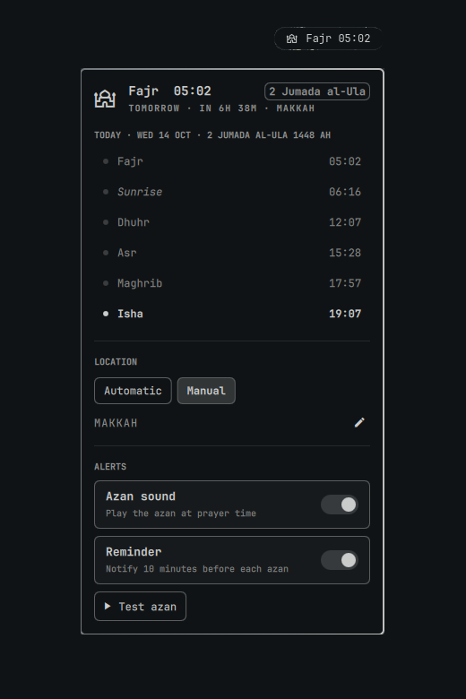

# Prayer Times

Islamic prayer times in the [Omarchy](https://omarchy.org/) status bar. It shows the next prayer, reminds you before each azan, plays the azan at prayer time, and finds your location automatically or lets you pick a city.



## Features

- **Next prayer in the bar**: `Asr 15:38`. It switches to a live `-9:59` countdown in the accent color when a prayer is close.
- **Reminder before the azan**: a notification 10 minutes before each prayer. The lead time can be changed or turned off.
- **Azan at prayer time**: a notification, plus your azan audio if you set one. A switch in the popup turns the sound on or off. Fajr can use its own azan.
- **Automatic or manual location**: automatic uses your IP and refreshes every 6 hours. Manual has a city search, the same one the Omarchy weather widget uses.
- **Today's schedule**: Fajr, Sunrise, Dhuhr (shown as Jumu'ah on Fridays), Asr, Maghrib and Isha, with the Hijri date.
- **Works offline**: times are computed locally (PrayTimes algorithm). No API key, no account.
- **12 calculation methods**: MWL, Umm al-Qura (Makkah), Egypt, ISNA, Karachi, Tehran, Jafari, Gulf, Kuwait, Qatar, Singapore, Turkey. Standard or Hanafi Asr.
- **Follows your Omarchy theme**: built only from the shell's own panel components and theme colors.

## Install

```bash
omarchy plugin add https://github.com/AhmadRun/prayer-times --enable
```

The widget is placed on the right of the bar. To move it, use `omarchy plugin enable io.github.ahmadrun.prayer-times --section left|center|right`.

## Remove

```bash
omarchy plugin remove io.github.ahmadrun.prayer-times
rm -f ~/.local/state/omarchy/settings/prayer-times.json   # optional: saved location and switches
```

The plugin writes only its own state file. It never touches your other configuration, and it does not delete the azan audio files you added yourself.

## Dependencies

All of these come with a stock Omarchy install:

- `curl`: automatic location (`ipinfo.io`) and city search (Open-Meteo geocoding)
- `jq`: saving the plugin state file
- `notify-send`: reminder and azan notifications
- `mpv` or `pw-play`: azan playback

Nothing runs with elevated privileges, and nothing is downloaded or executed at install time.

## Usage

| Action | Result |
|---|---|
| Left click | Open the popup: today's times, location, alerts |
| Middle click | Test the azan, or stop it while it plays |
| `Esc` / `Tab` in popup | Close / move to the next bar panel |

IPC: `qs ipc -p /usr/share/omarchy/shell call io.github.ahmadrun.prayer-times toggle` opens the popup, and `... call io.github.ahmadrun.prayer-times.azan test` / `stop` / `remindTest` test the alerts. These work well as Hyprland keybindings.

### Adding the azan sound

No audio ships with the plugin. Download an azan recording you like (mp3, ogg or wav) and set its path in the plugin settings (**Azan sound file**, and optionally **Fajr azan sound file**):

```bash
mkdir -p ~/.local/share/sounds/azan
# put azan.mp3 (and fajr.mp3) there, then pick it in the plugin settings
```

Playback uses `mpv` when installed, and `pw-play` otherwise.

## Settings

Open these from the bar's widget settings:

| Setting | Default | Notes |
|---|---|---|
| Calculation method | MWL | Pick the one your local mosque uses |
| Asr calculation | Standard | Hanafi gives a later Asr |
| Time format | 24h | or 12h |
| Reminder before azan | 10 min | 0 turns it off |
| Azan / Fajr azan sound file | none | notification only when empty |
| Adjust all times | 0 min | fine-tune to your mosque's timetable |
| Hijri date adjustment | 0 days | correct for local moon sighting |

The popup switches (location mode, azan sound, reminder) are stored in `~/.local/state/omarchy/settings/prayer-times.json`.

## Notes

- Times are shown in your **system timezone**. With a manual city in a different timezone, set your system timezone to match.
- Automatic location uses `ipinfo.io`, and city search uses Open-Meteo geocoding. The last location is cached, so prayer times keep working offline. If both are unavailable, the location set in the Omarchy weather widget is used.
- The Hijri date uses the tabular calendar and can differ by a day from local moon sighting. Use **Hijri date adjustment** if needed.

## Development

```bash
node tests/test_prayer_times.js   # calculation vs. Aladhan reference times
dev/sync.sh                       # validate, copy into ~/.config/omarchy/plugins, enable
dev/sync.sh --copy                # copy only
omarchy restart shell             # QML code changes need a shell restart
```

## License

MIT. The prayer-time calculation is adapted from [PrayTimes.org](http://praytimes.org/) by Hamid Zarrabi-Zadeh.
